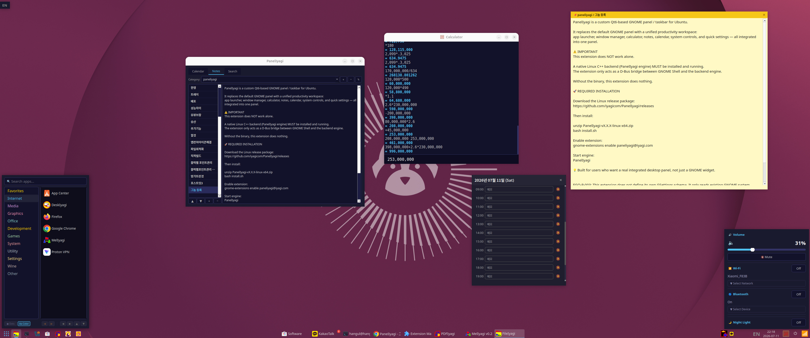

# PanelIyagi

**A real taskbar for Ubuntu GNOME — start menu, taskbar, tray, clock and calendar in one bar, like the desktop you're used to.**

[English](README.md) · [한국어](README_ko.md)



## Why PanelIyagi?

- **GNOME, the familiar way.** A start menu, a taskbar with every open window, a system tray and a clock — all in one panel. No Activities overview needed to switch windows.
- **Everything one click away.** Apps by category, favorites, and live search in the launcher. Pin the apps you use every day.
- **More than a clock.** Click the clock for a calendar with notes, sticky notes, alarms and a monthly to-do list.
- **A calculator that lives in the panel.** Type a whole expression, keep history, add comments, sum a selection.
- **See your PC at a glance.** CPU and RAM usage right in the panel; volume and quick settings a click away.

## Features

### Launcher and taskbar
- App menu with categories, favorites, real-time search, custom entries
- Open-window list with active-window highlight, click to minimize/raise
- Pin apps, group windows, kill a hung process

### Tray and status
- System tray (XEMBED), CPU/RAM display
- Volume and quick settings

### Clock, calendar, notes
- Calendar with per-day notes and timed alarms
- Sticky notes, monthly tasks, quick notes, full-text search

### Calculator
- Expression calculator in a panel popup or its own window
- History, comments, selection sum, always-on-top

## Download

**[⬇ Latest release](https://github.com/iyagicom/PanelIyagi/releases/latest)**

| Your system | File to pick |
|---|---|
| Ubuntu 24.04 · Debian | `.deb` marked **ubuntu24.04** |
| Ubuntu 26.04 | `.deb` marked **ubuntu26.04** |
| Fedora · openSUSE | `.rpm` |
| Arch · Manjaro | `.pkg.tar.zst` |
| Any other Linux | `.AppImage` or `.zip` |
| GNOME Shell extension only | `paneliyagi-extension-*.zip` |

```bash
sudo apt install ./paneliyagi_*_amd64.deb    # Ubuntu / Debian
sudo dnf install ./paneliyagi-*.rpm          # Fedora
sudo pacman -U paneliyagi-*.pkg.tar.zst      # Arch
```

The package installs the app and its GNOME Shell extension and turns them on. Log out and back in once so GNOME picks up the extension.

For GNOME. Using KDE Plasma, XFCE, Cinnamon, MATE, LXQt or sway? See **[TaskIyagi](https://github.com/iyagicom/TaskIyagi)**.

## License

[License](LICENSE)
